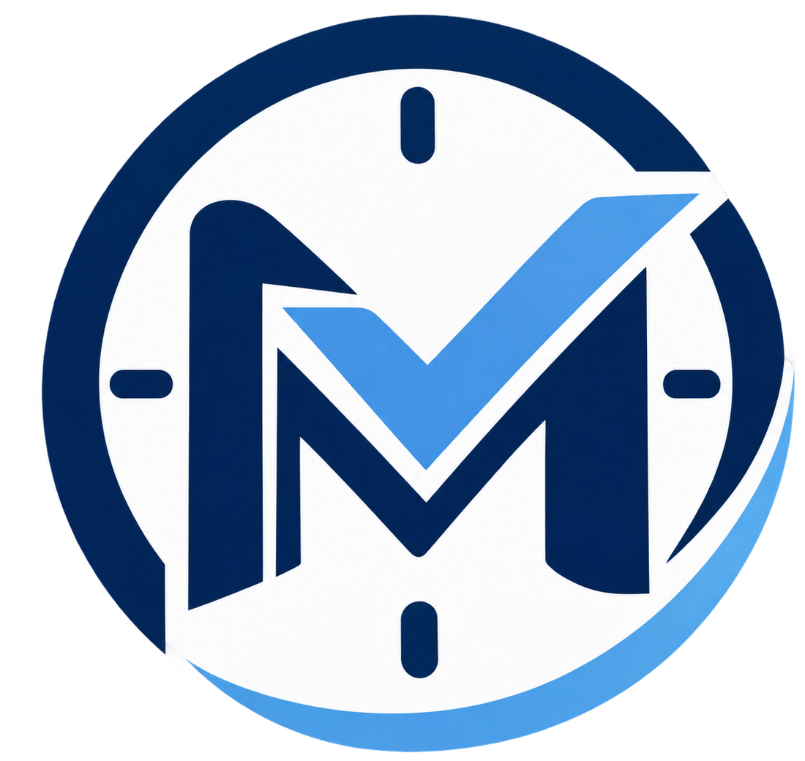

  

<h1 align="center">Meu Ponto</h1>

<strong>Sua jornada, seus registros e seus ganhos em um só lugar.</strong>

  <a href="https://igorbarbosadas.github.io/meuponto/">Acessar aplicativo</a>

O **Meu Ponto** é um aplicativo de acompanhamento de jornada de trabalho. Nele, você registra suas batidas, acompanha as horas trabalhadas e consulta estimativas de adicionais e remuneração de forma simples, pelo celular ou computador.

## O que você encontra no Meu Ponto

**Registro de ponto**  
Marque a entrada e a saída pelo horário atual ou adicione uma batida manualmente. Caso precise, edite ou exclua uma marcação incorreta.

**Acompanhamento da jornada**  
Visualize o tempo trabalhado, o status da jornada e os ganhos estimados enquanto o expediente está em andamento.

**Calendário e escala**  
Consulte os dias trabalhados, jornadas abertas, folgas, dias pendentes e feriados. Personalize os dias da sua escala conforme sua rotina.

**Relatórios de ganhos**  
Acompanhe horas efetivas, horas extras, adicional noturno, feriados, DSR e uma previsão de salário bruto e líquido. O relatório apresenta o detalhamento dos cálculos.

**Configurações flexíveis**  
Defina salário-base, valor da hora, horário contratual, intervalo e percentuais dos adicionais conforme as regras aplicáveis ao seu trabalho.

**Acesso e sincronização**  
Entre com sua conta e sincronize seus registros com a nuvem. Há opções de backup e exportação de dados.

## Como começar

1. Abra o [Meu Ponto](https://igorbarbosadas.github.io/meuponto/).
2. Crie uma conta ou entre com seu e-mail e senha.
3. Acesse **Ajustes** e configure as regras da sua jornada.
4. Registre sua entrada ao iniciar o trabalho e sua saída ao terminar.
5. Consulte **Meu ponto** para revisar as batidas e **Relatórios** para acompanhar o mês.

## Use no celular

O Meu Ponto funciona no navegador e pode ser adicionado à tela inicial do telefone.

- **Android:** abra o site no Chrome e procure **Instalar aplicativo** ou **Adicionar à tela inicial**.
- **iPhone:** abra o site no Safari, toque em **Compartilhar** e selecione **Adicionar à Tela de Início**.

## Seus dados

O aplicativo utiliza autenticação e sincronização com **Supabase**, com políticas de acesso vinculadas a cada usuário. Também oferece opções para exportar cópias dos registros. A disponibilidade de dados sem internet depende do que já estiver salvo no dispositivo.

Os valores financeiros exibidos são **estimativas** e devem ser comparados com o espelho de ponto e o contracheque.

---

<strong>Meu Ponto</strong> · Acompanhe seu tempo. Entenda seus ganhos.

